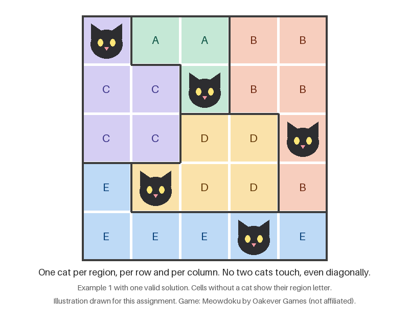

# Assignment 5: Meowdoku Solver (Backtracking)



*Illustration drawn for this assignment. Game: Meowdoku by Oakever Games (this course is not affiliated with the game's publisher).*

## Background

Meowdoku is played on an N×N grid that is divided into N colored regions. You place N cats so that:

1. Every region contains exactly one cat.
2. No two cats share a row or a column.
3. No two cats touch, including diagonally.

Your job is to write a program that solves a Meowdoku board using **backtracking**.

## Your task

Write a Java program in a **single class named `Meowdoku`, in a single file `Meowdoku.java`**. It must:

1. Read a puzzle from the **file whose path is given as the first command-line argument**.
2. Solve it with a backtracking search.
3. Print a solution (or `NO SOLUTION`) to **standard output**.

How you organize the code inside that class is up to you: fields, helper methods and a nested class or two are all fine, as long as `Meowdoku` has a `public static void main(String[] args)` and the program behaves as described here. **Only your program's output is graded.**

```
javac Meowdoku.java
java Meowdoku puzzles/pub_a3_n5.txt
```

Rules for your submission:

- Your program must read the puzzle from the file named in `args[0]`. **Do not read the puzzle from standard input** and do not use input redirection (`< file`).
- Your solution is **one file, `Meowdoku.java`, at the top level of your repository**. The whole repository gets submitted, but only `Meowdoku.java` is compiled, so do not depend on any other file you wrote. No other top-level classes.
- No `package` statement. Use only the Java standard library.
- Print only the answer to standard output. Send any debugging text to standard error (`System.err`), or remove it before you submit.

## Input file format

```
5
CAABB
CCABB
CCDDB
EDDDB
EEEEE
```

- Line 1 is N, with 1 ≤ N ≤ 15.
- The next N lines each contain N uppercase letters with no spaces. Each letter names a region. There are exactly N different letters, and every region is a connected group of cells.
- Be tolerant of Windows line endings (`\r\n`), spaces at the ends of lines and extra blank lines at the end of the file.

## Output format

- If the board has a solution, print N lines of N characters each: `*` where a cat goes and `.` everywhere else.
- If the board has no solution, print exactly `NO SOLUTION`.

**Any valid solution is accepted.** Many boards have more than one answer, and the grader checks your answer against the rules instead of comparing it to a fixed file. You do not need to find all solutions, and you should stop as soon as you have found one.

## Examples

**Example 1** (see the picture above; this board has several valid answers). One valid output:

```
*....
..*..
....*
.*...
...*.
```

**Example 2** (no solution), input `puzzles/pub_b1_n5.txt`:

```
5
AAAAA
ABBBA
ACCCA
ADDDA
AAAAE
```

Output:

```
NO SOLUTION
```

**Example 3**, input `puzzles/pub_a2_n4.txt`:

```
4
AABB
AABB
CCDD
CCDD
```

One valid output (another valid answer exists):

```
.*..
...*
*...
..*.
```

## Testing your work locally

This folder contains public test puzzles in `puzzles/` and a test harness, `run_tests.py`. The harness compiles your `Meowdoku.java`, runs your program on each puzzle, and checks the output with the same validator the autograder uses. It needs Python 3 and a JDK.

```
python3 run_tests.py                     # compile ./Meowdoku.java and run every public puzzle
python3 run_tests.py --src path/to/src   # the folder that contains Meowdoku.java
python3 run_tests.py --one puzzles/pub_c1_n6.txt   # run one puzzle and see your output
```

The harness runs all 19 public puzzles, including the two that check how the file is passed to your program (a path with spaces, and junk on standard input). Passing all of them locally is worth 80 of the 100 points. The other 20 points come from hidden boards, including the largest size (N = 15), so make your own test puzzles too. Think about N = 1, boards with no solution, and boards with many solutions.

## Grading

Your grade is **100% autograder tests**. There is no style or manual grading. Each test is all-or-nothing, and each run of your program has a **10 second** limit, including JVM start-up.

| Category | What it checks | Public | Hidden | Total |
|---|---|---:|---:|---:|
| Small boards | Solvable boards with N ≤ 5 | 16 | 4 | 20 |
| Unsolvable boards | `NO SOLUTION`, including bigger boards where you must search the entire tree | 16 | 4 | 20 |
| Many solutions | Boards with many valid answers; any one is accepted | 12 | 3 | 15 |
| Medium boards | Solvable boards with N from 6 to 9 | 16 | 4 | 20 |
| Large boards | Boards with N from 12 to 15, where pruning matters | 12 | 3 | 15 |
| File handling | Path argument, spaces in the path, stdin ignored, Windows line endings | 8 | 2 | 10 |
| **Total** | | **80** | **20** | **100** |

The public tests (80 points) use the puzzles in your `puzzles/` folder, and their results show up as soon as you submit to Gradescope. The hidden tests (20 points) use other boards and are run on every submission too, but their results are only revealed after grades are published. Passing every public puzzle locally means you are on track for 80 points, but write your own extra boards to be confident about the rest.

If your code does not compile, you get 0 on everything. The autograder shows you the compiler's message.

## Hints

- Every row of a solution contains exactly one cat, so you can place cats one row at a time.
- Decide before you recurse whether a placement is legal. Pruning bad branches early is what makes N = 15 fast.
- When a recursive call fails, undo what you changed before you try the next choice.
- Which earlier placements can a new cat touch? Because you place row by row, that is a short list.
- Searching an entire tree to prove `NO SOLUTION` must also finish in time.
